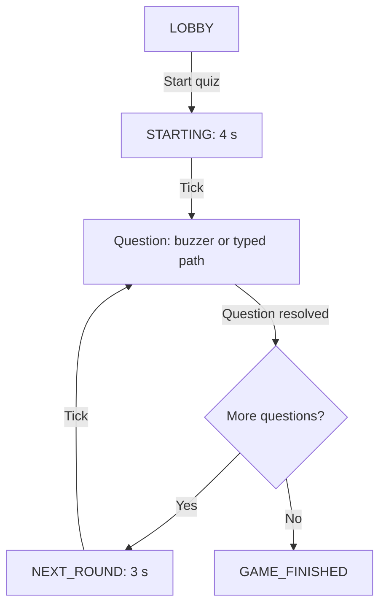
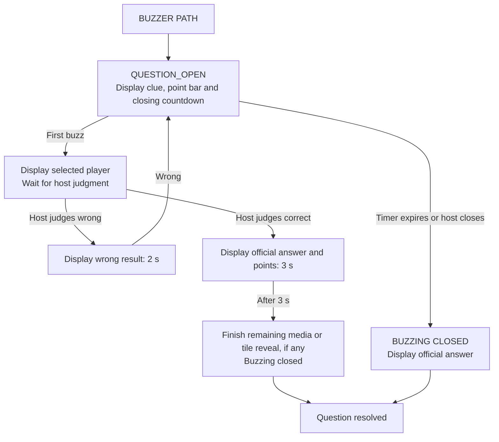
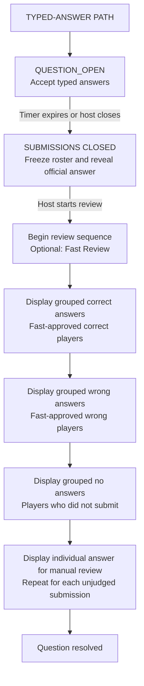

# Quiz logic overview

This document describes the behavior implemented in the current code, rather than a proposed game design. The server's [GameEngine](src/server/engine.ts) owns the rules and phases; [protocol.ts](src/shared/protocol.ts) defines valid questions and snapshots. The TV, host console, and phones render server snapshots and cannot decide winners or award points themselves.

## 1. What is loaded before a game starts

1. [index.ts](src/server/index.ts) reads root `settings.json`, selects the quiz using `server.startupQuizId` (or `QUIZ_ID`), and loads `quizzes/<id>/quiz.json` and its media. Invalid settings or quiz data stop startup.
2. The server merges built-in game defaults, root `gameSetup`, then the quiz archive's `gameSetup`; later values win. Server-only options are separate. The quiz title comes from `quiz.title`. Duration probing reads supported local audio/video files at startup so the engine can estimate clip endpoints.
3. The game starts in `LOBBY`, with no active question and no players. Players may join up to `server.maxPlayers`; disconnected players still occupy a place until removed. Game setup can be saved only in the lobby. The host's **Start quiz** command begins the game; it does not open question 1 immediately.
4. `STARTING` lasts four seconds. The TV shows **3 → 2 → 1 → LET'S GO!**. Play and ordinary host controls are blocked. When the server tick reaches the boundary, question 1 opens with its full timer and starting points. Media starts at its configured playback start, or zero when none is set.

The quiz and settings are saved, but live players, scores, phase and progress are only in memory. Restarting the server starts a new lobby. An editor save does not replace an already loaded quiz; in development, **Restart quiz** clears the live game and reloads the saved quiz. Production does not allow that command.

For the currently checked-in `settings.json` and quiz `100001`, the effective defaults are **12 players**, **30 seconds** per question unless overridden, and buzzer points starting at **500**, falling by **20** every **1 second** after a **5-second** delay, down to **100**. Wrong-answer lockout is **2 seconds**. Saved Game setup or question-level timers can change these values; consult the loaded quiz when diagnosing a live game.

## 2. The two independent question choices

Every question has a **type** (`text`, `image`, `audio`, `video`) and a **mode** (`buzzer`, `typed`). Any type can use either mode. `question` is the heading; `answer` is private to the host until reveal or the appropriate review. Optional `keyword` is stored with the quiz but does not control runtime play.

| Type | What the TV does | Type-specific options |
| --- | --- | --- |
| `text` | Displays `text`, falling back to `question`. | Optional `text`. |
| `image` | Displays the image immediately or uncovers deterministic tiles over time. | `media`; optional `reveal` (`static` or `tiles`, duration, grid, seed). |
| `audio` | Plays audio on the TV; may show a frequency visualizer. | `media`; optional playback start/end and visualizer. |
| `video` | Plays video on the TV. | `media`; optional playback start/end. |

The mode controls scoring and interaction, regardless of type:

| Mode | Player action | Points | End of input |
| --- | --- | --- | --- |
| `buzzer` | First accepted buzz gets the floor; answer is spoken and judged by the host. | Value falls in steps from `startPoints` to `minimumPoints`; a correct ruling adds the value frozen at buzz, while a wrong ruling subtracts half, rounded up. | Buzzing closes at `timerSeconds` (or the game default), unless the host closes earlier or a correct ruling ends the question. |
| `typed` | Each player may submit one final text answer. Host reviews it; there is no automatic answer matching. | `fixedPoints` is required; correct adds it, wrong or missing adds zero. No point reduction. | Submissions close at `timerSeconds` (or the game default), unless the host closes earlier. |

`timerSeconds` is optional for **both** modes; without it, `gameSetup.questionTimerSeconds` applies. The visible typed countdown and submission deadline reach zero together. Buzzer questions show one point bar and a separate numeric countdown to buzzing close.

## 3. Clocks and points

The **clue clock** is authoritative for input deadlines and buzzer points. It runs in `QUESTION_OPEN`, stops when paused or when a player buzzes, and resumes after a wrong buzzer result. The host can pause/resume only an open question. The server rejects a buzz or typed submission at the deadline even if its periodic tick has not yet changed the phase. The tick normally runs every 200 ms, so visible phase changes may arrive slightly after the exact boundary.

For buzzer questions, `pointDecayDelaySeconds` holds `startPoints` first. Thereafter, every `dropEverySeconds` subtracts `dropPoints`, never below `minimumPoints`:

```text
points = max(minimumPoints,
             startPoints - floor(max(0, clueElapsed - pointDecayDelay) / dropInterval) × dropPoints)
```

The point bar shows progress through this reduction window and stops at minimum. Reaching minimum **does not** close buzzing. The numeric countdown uses the question timer, independently of the point bar and delay. A buzz freezes both clue time and the exact point value at that moment. There is no timer for how long the selected player has to speak.

The **display/media clock** can continue after the clue clock stops. A typed video, or a buzzer video closed while still playing, continues toward its clip endpoint after input closes. Buzzer media pauses while a player is answering and during a ruling. On a correct ruling, the official answer appears immediately for three seconds; then remaining media resumes with buzzing closed. The quiz advances when media finishes. Host pause, browser playback restrictions and missing files can also interrupt what the TV actually plays.

## 4. Game phases and transitions

The shared flow is short. A question follows **one** of the two mode-specific paths below; both return to the same choice between another question and final standings.



"Question resolved" means the three-second correct buzzer answer display and any remaining media have ended, the host has advanced a closed buzzer question, or typed-answer review has completed. The diagram describes the shared path, not a literal single `Question` phase. On the last question, resolution goes directly to `GAME_FINISHED`. `REVIEW_COMPLETE` is an internal review completion phase that normally immediately initiates this transition.

### Buzzer path

This diagram includes a **proposed simplification** for the no-correct-answer path: when buzzing closes, the official answer is shown and the question resolves. The current engine instead waits for the host to reveal and/or advance.



1. In `QUESTION_OPEN`, connected, eligible players may buzz. The server accepts only the first; it freezes time and points and enters `ANSWERING`. Other buzzers close. A player who disconnects while answering remains selected until the host rules or closes.
2. The host judges **Correct** or **Wrong**. A correct answer adds the frozen value; a wrong answer deducts half, rounded up to a whole point. `BUZZ_RESULT` shows a wrong result for two seconds or the official answer and awarded points for three seconds. The clue clock and media stay frozen during the hold.
3. **Wrong:** the player is locked out. With `lockoutSeconds = 0`, the lockout lasts for this question; with a positive value, it expires after the result hold plus that many seconds. Timed lockout continues through pauses and other players' answers. After the result hold, the question reopens and the clue clock resumes for eligible players.
4. **Correct:** the answer appears immediately while media is paused. After three seconds, remaining audio/video playback or tile reveal resumes with buzzing closed. The quiz advances automatically when it finishes. If its endpoint is unknown, the host skips the finishing media when ready.
5. If time runs out while the question is open, it enters `QUESTION_CLOSED`. In the proposed flow, the official answer is then displayed and the question resolves. Currently, the host may reveal the answer and/or advance. Media ending or points reaching minimum alone never closes buzzing.

### Typed-answer path — proposed simplification

This diagram is a **target flow for a later refactor**, not the current engine behavior. Here, “reveal correct answer” means displaying the official answer on the TV; “correct group” means players whose submissions the host has already marked correct. Showing the official answer does not judge any player automatically.



1. While open, each player can submit once. The host does not judge answers yet.
2. When the timer expires, or the host closes early, submissions stop and the review list is finalized. The official answer appears on TV. Before starting review, the host may optionally mark submitted answers correct or wrong privately; these fast judgments award points immediately. Closing alone must **not** start review, even if every answer has already been judged.
3. The host starts review explicitly from the closed state. The engine shows nonempty groups in a fixed order: **fast-approved correct**, **fast-approved wrong**, then **no answer** (zero points). Each group is shown once; empty groups are skipped. Players who submitted but have not been judged belong to none of these groups.
4. After the groups, the host manually judges remaining unjudged submissions in submission order. Each result uses the existing individual hold/animation. When none remain, the question resolves and the shared next-question/final flow resumes.

**Current implementation differs:** it combines fast-approved wrong and missing answers in one group. The official answer is visible while submissions are closed and disappears only when the host starts review. Closure and host-triggered review are now separate steps, and fast judgments are limited to the closed state.

## 5. Current host actions and reset behavior

- **Close / skip question** stops an open buzzer or typed question early; it can also close while someone is answering. Closing a typed question builds the review roster. **Reveal answer** requires a closed buzzer question or completed typed review.
- **Reset this question** opens the same question again with a new instance ID, fresh timer, media position, lockouts and typed submissions. It does **not** roll back scores already awarded; use **Undo** for the last score change. Reset is unavailable after final standings.
- **Restart media only** changes media position/version without resetting the question timer or points. It is available while the question is open or in `MEDIA_FINISH`. **Skip finishing media** applies only in `MEDIA_FINISH` and advances the quiz.
- **Undo last score change** restores the saved score and clue state for that ruling or manual adjustment. It can cancel a buzzer result, review hold, media finish or next-round countdown. Undo history is capped at 100 and clears when a new question opens. Commands carry a revision and unique ID so stale commands are rejected and repeats are idempotent.
- **Restart quiz** clears players, scores and current progress, returning to `LOBBY`. In development, the server then reloads saved quiz/settings/media; the command is unavailable in production.

Most game controls are blocked during `STARTING`, `NEXT_ROUND`, `BUZZ_RESULT`, `MEDIA_FINISH` and `REVIEW_GROUP`, with phase-specific exceptions such as undo, reset or media controls. See the guards in [engine.ts](src/server/engine.ts) for the exact command permissions.

## 6. Current media and visibility boundaries

Only the TV plays audio/video. Playback start/end may constrain the clip; the server probes the natural duration of local WAV, MP3 and MP4 files. A correct buzzer ruling resumes remaining media after its three-second answer display. Unknown duration during `MEDIA_FINISH` needs a host skip. Browser autoplay, decoding or buffering can disagree with the server clock, so the host may need to enable or restart TV playback.

The public question omits the official `answer`; the host receives it privately. Typed submissions are sent only to the host until a particular answer is shown during review. TV and phone countdowns interpolate between server snapshots, but the server remains authoritative for deadlines, first buzz, scores and phase changes. The editor's TV preview simulates a question timeline; it is not a live game or a player-submission simulation.

## 7. Refactor checklist for the proposed typed path

- [x] Use the closed typed state as a waiting point: submissions and roster frozen, official answer visible, review started only by an explicit host action. The existing `QUESTION_CLOSED` phase is sufficient.
- [x] Make timer expiry and **Close submissions** use the same close operation. Remove automatic review start when all entries are pre-judged, and require closure before **Start review** is available; there is no direct open-to-review shortcut.
- [x] Restrict fast approval to the closed state before review. Award its points immediately; undo restores judgments, scores, the revealed answer, and the waiting state.
- [ ] Partition the frozen review roster exactly once into fast-approved correct, fast-approved wrong, no-answer, and unjudged submitted entries. No-answer players should not be mixed into the wrong group or appear again in manual review; empty groups should be skipped.
- [ ] Specify group timing and what appears on TV and phones while the official answer is visible, while each group is shown, and during individual manual review. Preserve answer privacy until the intended reveal point.
- [ ] Update host controls and phase guards so review begins only on the host's command and cannot be bypassed by **Next question**. Preserve reset, restart, reconnect, and media playback behavior while waiting for review.
- [ ] Update server snapshots, client rendering, and editor preview to reflect the new closed/revealed waiting step and separate no-answer group.
- [ ] Add transition tests for timeout, early close, zero submissions, all pre-judged, mixed groups, empty groups, manual review, pause, undo, reset, last question, reconnect, and video continuing after submissions close. Update existing tests that assert automatic review or the combined wrong/missing group.
- [ ] Once behavior is implemented and verified, revise the earlier “current behavior” sections of this file and the README to match the new flow.
